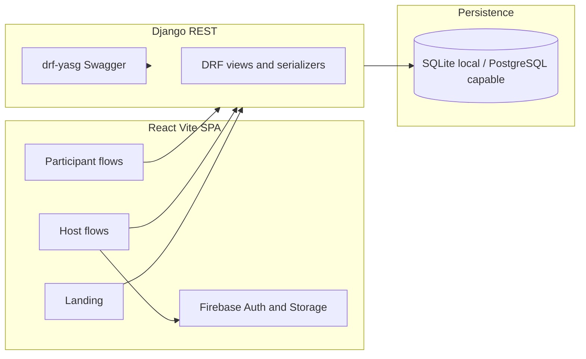

# CodeHut — Coding Contest Platform

A full-stack web application for **organizing and joining coding contests** aimed at student clubs, colleges, and small communities that want a lightweight alternative to large competitive-programming platforms (where hosting your own contest is often impossible or gated).

This repository is a **portfolio-grade project**: it shows end-to-end product thinking, a normalized domain model for contests, and a working host workflow backed by a Django REST API and a React (Vite) client.

---

## Why this project exists (genuine motivation)

Major platforms optimize for *their* contests, not *yours*. Student chapters and local organizers still rely on spreadsheets, ad hoc forms, and scattered communication. This project explores what it takes to **own the lifecycle**—registration windows, contest metadata, problem sets, prizes, and participant identity—in one place, with room to grow into submissions, judging, and integrity tooling later.

---

## What is implemented today

| Area | Status |
|------|--------|
| Public marketing / landing | Implemented |
| Sign up / sign in (Firebase Auth) + Django user record | Implemented |
| Protected routes (session via Firebase `onAuthStateChanged`) | Implemented |
| Host dashboard, contest list, multi-step contest creation & edit | Implemented |
| Contest details, problems attached to contests, prizes CRUD (API + UI) | Implemented |
| Banner images via **Firebase Storage** | Implemented |
| Participant contest browsing / registration (API) | Implemented |
| Participant dashboard shell | Implemented |
| OpenAPI / Swagger docs for the REST API | Implemented (`/swagger/`) |
| Leaderboard UI (search, sort, pagination) | UI with **static demo data** (ready to wire to `Ranking`) |
| Questions / problem statement UI | **Static demo** list (patterns ready for API-driven problems) |
| Automatic code execution & judging | **Not wired**; schema includes `Submissions`, `TestCases`, `SubmissionResult`, `Ranking` for the next phase |

This split is intentional to document honestly for interviews: **the data model and APIs anticipate a full contest engine**; the most visible participant flows are partly demonstration layers you can connect to the backend as a follow-up story.

---

## Architecture (high level)



- **Frontend**: React 18, React Router, Vite, Bootstrap / MUI / mixed UI kit, Axios client with centralized error handling, context for auth state.
- **Backend**: Django 5 + Django REST Framework, `django-cors-headers`, multipart parsers for forms and uploads metadata, **drf-yasg** for interactive API documentation.
- **Auth model**: Firebase handles credentials on the client; on sign-up the app **syncs the user** to Django (`user_id` = Firebase UID) so relational data (contests, registrations) stays in your database.
- **Database**: Local development uses **SQLite**; `dj-database-url` and `psycopg2` are in dependencies so you can point at **PostgreSQL** for staging/production without changing application code.


---

## Quick start

### Backend

```bash
cd backend/coding_contest
python -m venv .venv
source .venv/bin/activate   # Windows: .venv\Scripts\activate
pip install -r requirements.txt
python manage.py migrate
python manage.py runserver
```

API base (default): `http://127.0.0.1:8000/`  
Swagger UI: `http://127.0.0.1:8000/swagger/`

### Frontend

```bash
cd front-end/coding_contest_app
npm install
npm run dev
```

Configure [`front-end/coding_contest_app/src/Constants.js`](front-end/coding_contest_app/src/Constants.js) if your API is not on `http://localhost:8000/`. Firebase must be configured in [`front-end/coding_contest_app/src/firebase/firebase.js`](front-end/coding_contest_app/src/firebase/firebase.js) for auth and storage to work.

---

## Domain model (technical depth)

The ORM layer models a realistic contest platform: users and extended profile data; contests with schedules, visibility, and registration deadlines; one-to-one **contest details**; **problems** with difficulty, weighting, and tags; **contest–problem** join with ordering; **prizes**; **registrations**; and forward-looking entities for **submissions**, **per-test-case results**, **rankings**, **languages**, and **samples**. That breadth is useful interview evidence: you can discuss migrations, integrity (`unique_together` on contest problems), and how you would add a judge service without redesigning the core schema.

---

## Impact & scope (credible, evidence-based)

Portfolio projects should not invent vanity metrics. The following are **directly grounded in this repo**:

- **Codebase scale (indicative)**: on the order of **~3k+ lines** in the React `src` tree and **~1k+ lines** in the Django app layer—enough to show non-trivial structure, routing, and API usage without claiming false production traffic.
- **API surface**: dedicated URL modules for `auth/`, `host/`, and `participant/` plus Swagger-documented endpoints—demonstrates **API partitioning by persona** and contract thinking.
- **User-visible flows**: multi-step contest authoring (basic details → about → challenges → prizes), edit routes with nested routing, and shared components (header, alerts, loading states)—shows **product-shaped UX**, not a single CRUD demo page.
- **Integration breadth**: **third-party auth**, **object storage** for assets, and **REST** with CORS—typical of real SaaS-style stacks.

If you add production metrics later (registrations per contest, time-to-create-contest, error rates), drop them into a “Production metrics” subsection—interviewers respond well to *real* numbers.

---

## Roadmap (honest next steps)

1. Connect **leaderboard** and **questions** views to live API data (`Ranking`, `ContestProblems`, etc.).
2. Implement a **submission pipeline** (queue + sandbox or external judge) and persist `Submissions` / `SubmissionResult`.
3. Optional: enable **Firebase token verification** on the API (scaffold exists in code but is commented) for defense-in-depth.
4. Harden **secrets** (environment variables, no committed credentials), tighten **CORS** for production, and run the app on **PostgreSQL**.

---

## Team

- [Narayan Jat](https://github.com/narayan-jat/)
- [Shravan Ram](https://github.com/shravanbishnoi/)
- [Pankaj Yadav](https://github.com/panakajyadav8523/)

---

## License

See team preference; API metadata references MIT in Swagger contact/license fields—align the repository license file with your chosen terms when you publish.
